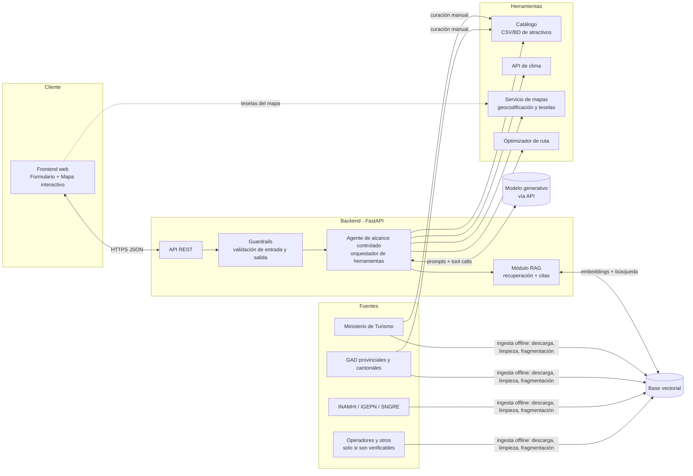

# Arquitectura

**Versión:** 0.1 (Semana 1) · Diseño propuesto; no implementado.

## 1. Vista general



### Componentes

| Componente | Responsabilidad | Nota |
|---|---|---|
| Frontend | Captura de parámetros, visualización de itinerario, mapa y citas | Tecnología por definir (Semana 2) |
| API REST | Validación, autenticación futura, endpoints (`/health`, `/itinerario`) | FastAPI |
| Guardrails | Rechazar fuera de alcance; defensa ante prompt injection; verificar salida | Reglas + validación contra catálogo |
| Agente | Decide qué herramienta invocar, con límite de pasos y herramientas de solo lectura | Alcance controlado |
| RAG | Recupera fragmentos y construye citas | No se implementa en Semana 1 |
| Base vectorial | Almacena embeddings de fragmentos y metadatos de fuente | Opción a definir (p. ej., Qdrant, Chroma o pgvector) |
| Catálogo | Fuente de verdad de los atractivos permitidos | `data/catalogo/atractivos.csv` |
| API de clima | Pronóstico por coordenadas y fecha | Proveedor por definir y verificar términos |
| Servicio de mapas | Teselas, geocodificación del punto de partida | Preferir opción abierta con atribución |
| Optimizador | Ordena visitas minimizando traslado | Se detalla en Semana 3 |

### Principios

1. **El catálogo manda:** el agente solo puede mencionar atractivos que existan en él.
2. **Toda afirmación factual lleva cita** o se omite.
3. **Herramientas de solo lectura y lista cerrada.**
4. **Degradación segura** ante fallos de servicios externos.

## 2. Diagrama de secuencia: consulta de itinerario

```mermaid
sequenceDiagram
    autonumber
    actor V as Visitante
    participant FE as Frontend
    participant API as Backend (API)
    participant GR as Guardrails
    participant AG as Agente
    participant LLM as Modelo generativo
    participant CAT as Catálogo
    participant RAG as RAG + Base vectorial
    participant CLI as API de clima
    participant OPT as Optimizador de ruta
    participant MAP as Servicio de mapas

    V->>FE: Envía días, presupuesto, punto de partida, intereses
    FE->>API: POST /itinerario (JSON)
    API->>GR: Validar entrada (esquema, rangos, texto libre)
    alt Entrada inválida o fuera de alcance
        GR-->>API: Rechazo con motivo
        API-->>FE: Error 4xx / mensaje de alcance
        FE-->>V: Explica qué corregir
    else Entrada válida
        GR-->>AG: Solicitud validada
        AG->>MAP: Geocodificar punto de partida
        MAP-->>AG: Coordenadas
        AG->>LLM: Plan inicial + herramientas disponibles
        LLM-->>AG: Llamada a herramienta: buscar_catalogo(intereses, presupuesto)
        AG->>CAT: Consultar atractivos candidatos
        CAT-->>AG: Lista de atractivos (con campos POR VERIFICAR marcados)
        AG->>OPT: Agrupar por día y ordenar visitas
        OPT-->>AG: Orden y tiempos de traslado
        par Clima por día
            AG->>CLI: Pronóstico (coordenadas, fechas)
            CLI-->>AG: Pronóstico o error
        and Fragmentos para citas
            AG->>RAG: Recuperar fragmentos por atractivo
            RAG-->>AG: Fragmentos + metadatos de fuente
        end
        AG->>LLM: Redactar itinerario usando solo datos recibidos
        LLM-->>AG: Borrador con referencias a fragmentos
        AG->>GR: Verificar salida (atractivos en catálogo, citas válidas)
        alt Verificación falla
            GR-->>AG: Corregir o eliminar afirmaciones no respaldadas
            AG->>LLM: Regenerar (máx. N intentos)
        end
        AG-->>API: Itinerario estructurado + citas + costos + clima
        API-->>FE: 200 JSON
        FE-->>V: Itinerario por día, mapa con ruta y citas
    end

    opt Recálculo
        V->>FE: Cambia días, presupuesto o excluye atractivo
        FE->>API: POST /itinerario/recalcular
        API->>AG: Reutiliza contexto y recalcula
        AG-->>FE: Nuevo itinerario con diferencias
    end
```

## 3. Decisiones pendientes

| Tema | Opciones | Fecha límite sugerida |
|---|---|---|
| Base vectorial | Qdrant, Chroma, pgvector | Semana 2 |
| Modelo de embeddings multilingüe | Por evaluar con textos en español | Semana 2 |
| API de clima | Open-Meteo, OpenWeatherMap, otra | Semana 2 |
| Servicio de mapas y rutas | OpenStreetMap + OSRM/OpenRouteService, otro | Semana 2 |
| Framework del frontend | Por definir | Semana 2 |
